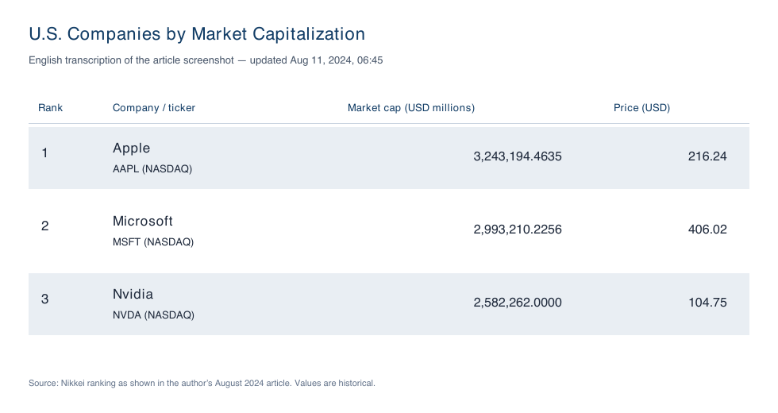

<!-- English translation of the author's Japanese Qiita article. Statements and results reflect the article as written in August 2024; they have not been updated. -->

# Introduction
Hello, everyone.
Have you heard of a company called Cohere?

[Cohere](https://cohere.com/) (pronounced kōˈhir) is a Canadian multinational company that provides LLMs (large language models) for enterprises. Recently, Fujitsu and Cohere began jointly developing a Japanese LLM tentatively called [Takane](https://pr.fujitsu.com/jp/news/2024/07/16.html), which can be used in private environments (July 16, 2024).

Cohere is also known for the quality of its documentation.

https://qiita.com/sergicalsix/items/d5c7a0a420a213309bfc

https://x.com/hAru_mAki_ch/status/1776272185893822725

For this article, I used the page below from the documentation's [Cookbooks](https://docs.cohere.com/page/cookbooks), which contain various implementation guides, to build a **simple AI data analyst agent that analyzes companies' sales growth rates**. I'll explain how I built it and share my impressions after using it.

Reference page:

https://docs.cohere.com/page/data-analyst-agent

(This is my first article, so I may have missed things. If so, I would appreciate corrections or additional information :bow:)

# Architecture and process flow
The reference page also describes the architecture, but I have organized it in the diagram below.


1. The AI agent (Data Analyst Agent) receives a prompt (instructions) from the user.
1. Before passing the prompt to the LLM, a [**Prompt Template**](https://book.st-hakky.com/data-science/langchain-prompttemplate/) formats it.
1. The prompt is passed to the **LLM** for processing.
1. To answer the prompt, the agent chooses the next tool to run. It uses **Web Search** when it needs to search the internet and **Python Interpreter** when it needs to run Python code, such as for calculations or charts.
1. Finally, the AI agent returns a response to the user.

# Preparation before implementation
For the LLM, I use Cohere's Command R+. For the Web Search tool, I use [**Tavily**](https://tavily.com/), a search engine designed for AI agents.

You need to obtain an API key for each service. Both offered free use with some limits at the time of writing.

*Cohere API*
https://dashboard.cohere.com/api-keys
*Tavily API*
https://app.tavily.com/home

You also need to install the LangChain libraries. Run the following in a terminal:
```
! pip install langchain langchain_cohere langchain_experimental
```
# Implementation
Now for the implementation.
Put the following code in any directory and file you like.
### Setting the API keys
Set the Cohere and Tavily API keys obtained earlier.
```
import os
os.environ['COHERE_API_KEY'] = "<your Cohere API key>"
os.environ['TAVILY_API_KEY'] = "<your Tavily API key>"
```

### Configuring the LLM
Use LangChain to call Cohere's LLM.
For `temperature`, see [this reference](https://www.promptingguide.ai/jp/introduction/settings). I set `temperature=0` because I wanted the data analyst to give more fact-based answers.
```
from langchain_cohere.chat_models import ChatCohere
chat = ChatCohere(model="command-r-plus", temperature=0)
```

### Configuring Web Search
Tavily returns relevant document [snippets](https://japan.zdnet.com/glossary/exp/%E3%82%B9%E3%83%8B%E3%83%9A%E3%83%83%E3%83%88/?s=4#:~:text=%E3%82%B9%E3%83%8B%E3%83%9A%E3%83%83%E3%83%88%E3%81%A8%E3%81%AF&text=%E3%82%B9%E3%83%8B%E3%83%9A%E3%83%83%E3%83%88%E3%81%A8%E3%81%AF%E3%80%81%E4%B8%80%E8%88%AC%E7%9A%84,%E6%96%87%E3%81%AE%E3%81%93%E3%81%A8%E3%81%A7%E3%81%82%E3%82%8B%E3%80%82) for a text query.
```
from langchain_community.tools.tavily_search import TavilySearchResults
internet_search = TavilySearchResults()
internet_search.name = "internet_search"
internet_search.description = "Returns a list of relevant document snippets for a textual query retrieved from the internet."

from langchain_core.pydantic_v1 import BaseModel, Field
class TavilySearchInput(BaseModel):
    query: str = Field(description="Query to search the internet with")
internet_search.args_schema = TavilySearchInput
```

### Configuring Python Interpreter
Set up a tool to execute Python code.
```
from langchain.agents import Tool
from langchain_experimental.utilities import PythonREPL
python_repl = PythonREPL()
repl_tool = Tool(
    name="python_repl",
    description="Executes python code and returns the result. The code runs in a static sandbox without interactive mode, so print output or save output to a file.",
    func=python_repl.run,
)
repl_tool.name = "python_interpreter"

class ToolInput(BaseModel):
    code: str = Field(description="Python code to execute.")
repl_tool.args_schema = ToolInput
```

### Configuring the AI data analyst agent
Configure the agent to perform the requested task.
```
from langchain.agents import AgentExecutor
from langchain_cohere.react_multi_hop.agent import create_cohere_react_agent
from langchain_core.prompts import ChatPromptTemplate

prompt = ChatPromptTemplate.from_template("{input}")

agent = create_cohere_react_agent(
    llm=llm,
    tools=[internet_search, repl_tool],
    prompt=prompt,
)

agent_executor = AgentExecutor(agent=agent, tools=[internet_search, repl_tool], verbose=True)
```

### Writing the prompt
`"input": "<enter any prompt you like here>"`
My prompt was: **“Plot the sales growth rates of the three largest high-tech companies in the United States by market capitalization in 2024. Sales growth rate = (current-year sales − previous-year sales) / previous-year sales.”**
```
agent_executor.invoke({
    "input": "Create a plot of sales growth for the three largest high-tech companies in the U.S. by market capitalization in 2024 now. Sales growth rate = (current year sales - previous year sales)/previous year sales",
})
```

Run the file containing the code above.
In a terminal, move to the directory containing the file and run `python <filename>.py`.

# Results
The following chart was output in the same directory as the file.
(Sometimes it appeared after a delay, and sometimes it did not appear at all.)


As of August 11, 2024, the three largest U.S. companies by market capitalization were those shown below, so the selection appeared to be right (according to [Nikkei's site](https://www.nikkei.com/marketdata/ranking-us/market-cap-high/)).


[Original Japanese screenshot](https://qiita-image-store.s3.ap-northeast-1.amazonaws.com/0/3578596/e0a2ae40-9d4e-d1af-faee-666648c6602b.png)

As for their sales growth rates, I did not calculate them myself to check them—sorry.
(Apple's growth rate looks quite questionable, so it may be wrong.)

# Impressions after using it
At the time of writing (August 11, 2024), OpenAI's GPT-4o had been trained on data only through December 2023. When I gave it the same prompt, it selected the three largest U.S. companies by market capitalization as of the previous year. In that respect, I think the AI agent built here has an advantage because it searches the internet in real time. However, it cannot carry on a continuing conversation based on its previous response as ChatGPT can, and I do not find it reliable enough for everyday use.

Thank you for reading!
